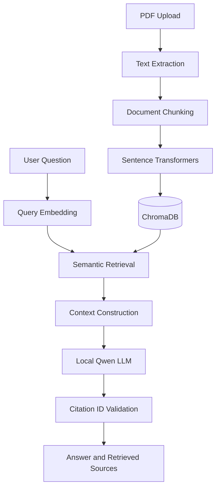

# AI Research Assistant

A locally hosted AI research assistant that uses
Retrieval-Augmented Generation (RAG) to answer
natural-language questions about uploaded PDF documents.

The application combines semantic vector search with
a local large language model to generate context-grounded
answers and provide traceable document sources without
requiring paid AI APIs.

## Features

- PDF upload, validation, and text extraction
- Document chunking with page-level metadata
- Semantic embeddings using Sentence Transformers
- Persistent vector storage using ChromaDB
- Similarity-based document retrieval
- Local LLM inference using Qwen2.5-0.5B-Instruct
- Retrieval-augmented answer generation
- Source tracking with filenames, page numbers,
  excerpts, and retrieval distances
- Validation of generated citation IDs
- Prompt-based handling of insufficient information
- REST API with interactive Swagger documentation
- 20 passing automated tests

## Architecture



## Tech Stack

| Component | Technology |
|---|---|
| Backend | Python, FastAPI |
| PDF Processing | PyMuPDF |
| Embeddings | Sentence Transformers |
| Vector Database | ChromaDB |
| Language Model | Qwen2.5-0.5B-Instruct |
| Model Inference | Hugging Face Transformers, PyTorch |
| Testing | pytest, FastAPI TestClient |
| API Documentation | Swagger UI |

## API Endpoints

| Method | Endpoint | Description |
|---|---|---|
| GET | /health | Health check |
| POST | /documents/upload | Upload and index a PDF |
| GET | /documents/search | Semantic document search |
| POST | /ask | Generate an answer from retrieved context |

## Getting Started

### 1. Clone the repository

```bash
git clone https://github.com/sanjanakumar06/ai-research-assistant.git
cd ai-research-assistant/backend
```

### 2. Create a virtual environment

Python 3.12 is recommended.

```bash
python3.12 -m venv .venv
source .venv/bin/activate
```

### 3. Install dependencies

```bash
python -m pip install -r requirements.txt
```

### 4. Start the backend

```bash
python -m uvicorn app.main:app --reload
```

Open http://127.0.0.1:8000/docs to interact with the API.

The embedding model and language model are downloaded
from Hugging Face when first needed and cached locally.
Initial requests may take longer due to model loading.

No paid API key is required.

## Example Usage

Upload a PDF using the /documents/upload endpoint.

Then submit a question to /ask:

```json
{
  "question": "What is gradient descent used for?",
  "top_k": 1
}
```

The API returns a generated answer alongside retrieved
document excerpts, filenames, page numbers, similarity
distances, and citation status.

## Testing

```bash
python -m pytest -v
```

The automated test suite covers:

- API health and input validation
- PDF upload validation
- Document chunking
- RAG pipeline orchestration
- Source metadata preservation
- Citation ID validation
- Empty database handling
- Question-answering endpoint behavior
- Generation failure handling

Retrieval and generation are mocked in RAG unit tests
to avoid unnecessary model inference.

## Responsible AI and Limitations

- Document retrieval and language model inference
  run locally.
- Uploaded document content is not sent to a hosted
  LLM API.
- Retrieved source metadata is preserved independently
  of model-generated text.
- Generated citation IDs are checked against retrieved
  sources.
- The model is prompted to acknowledge insufficient
  information rather than invent answers.
- Citation ID validation does not guarantee factual
  accuracy or that a source supports every claim.
- The lightweight language model may produce inaccurate
  answers or omit inline citations.

## Roadmap

- [x] FastAPI backend
- [x] PDF ingestion and text extraction
- [x] Document chunking and embeddings
- [x] Persistent vector database
- [x] Semantic search
- [x] Local LLM integration
- [x] Retrieval-augmented generation
- [x] Source tracking and citation ID validation
- [x] Automated testing
- [ ] Retrieval and generation evaluation benchmarks
- [ ] React frontend
- [ ] Streaming responses
- [ ] Document-specific search filters
- [ ] Deployment
